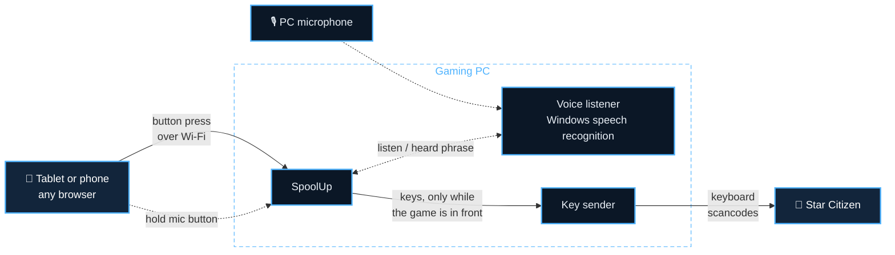

  

  
  
  
  

<h3 align="center">Turn any tablet or phone into a touch control panel for Star Citizen.</h3>

  A HUD-style button deck in your tablet's browser, where every button presses real keys on your gaming PC. 
  Free and open source. The tablet uses its browser, or the SpoolUp app on Android.

  <a href="https://github.com/xattribution/SpoolUp/releases/latest"><b>⬇&nbsp;Download for Windows</b></a>
  &nbsp;&nbsp;·&nbsp;&nbsp;
  <a href="https://xattribution.github.io/SpoolUp/try/"><b>▶&nbsp;Try it in your browser</b></a>
  &nbsp;&nbsp;·&nbsp;&nbsp;
  <a href="https://xattribution.github.io/SpoolUp/"><b>Website</b></a>

  

> [!NOTE]
> Fan project. Not affiliated with or endorsed by Cloud Imperium Games. Star
> Citizen and the manufacturer names belong to their owners; the emblems here
> are original designs, not the companies' logos.

**Contents:** [Features](#features) · [Get started](#get-started) ·
[Troubleshooting](#troubleshooting) · [Using SpoolUp](#using-spoolup) ·
[Settings](#settings) · [How it works](#how-it-works) ·
[Pairing and network](#pairing-and-network) · [Developers](#developers)

## Features

<table>
<tr>
<td width="50%" valign="top">

### 🛸 A HUD for your tablet
Landing, power management, quantum, operator modes, shields, targeting,
salvage, mining, doors, comms, emotes and more, on a HUD that fits your
screen: one panel at a time on a phone, two halves on a tablet, and wide
dashboards. **New in 2.2:** battle alerts from the game's log (hits, who
fired, your ship's state and your kills), 25 more buttons on the game's
default keys, no more stuck keys, and an Android app that finds your PC by
itself. In English, Español, Français or Deutsch.

</td>
<td width="50%" valign="top">

### 🎨 12 manufacturer themes
RSI, Drake, Aegis, Anvil, Origin, MISC, Crusader, Banu, Aopoa, Argo,
Consolidated Outland and Esperia, each its own design down to the dials,
switches and lit buttons: Drake's riveted, hazard-striped metal, Origin's cream
and black gloss, Argo's safety-yellow work panels, Banu's lacquer on carved
wood. The Stream Deck keys match. Plus night mode. Press animations for
landing-gear struts, the quantum charge ring, decoy sparks, sliding doors and
more, with HUD sounds on the tablet or in your headset.

</td>
</tr>
<tr>
<td valign="top">

### 🎙️ Hold-to-talk voice commands
"Landing gear", "engage quantum", "shields up": hold the mic button and speak.
Windows' built-in speech recognition, offline. The **?** next to the mic lists
everything you can say.

</td>
<td valign="top">

### ⌨️ Follows your keybinds
Reads your Star Citizen keybinds, on any drive and in any channel, so if you
rebind something in-game, the button follows. An optional keybind profile
covers actions that have no default key, and keeps the binds you already have.

</td>
</tr>
<tr>
<td valign="top">

### ✏️ Layout editor and starter layouts
Drag buttons and cockpit clusters on a snapping grid that fits every screen,
build your own dashboards, change keys, labels, icons and animations, and
share layouts as files. Or pick a starter layout for **Combat**, **Mining &
Salvage** or **Hauling & Exploration**, or one for the **Prospector** or
**Vulture**, separately on each tablet.

</td>
<td valign="top">

### 🖥️ A proper Windows app
One installer. A window with the QR code and pairing code, a tray icon, settings,
start with Windows, and updates with one click.

</td>
</tr>
<tr>
<td colspan="2" valign="top">

### 🎛️ Stream Deck
SpoolUp for Stream Deck, sold on the Elgato Marketplace, brings profiles for
every Stream Deck in all 12 themes, icon packs and a plugin that presses
through SpoolUp and keeps your tablet and Stream Deck on the same scene.
[More](#stream-deck)

</td>
</tr>
</table>

  

## Get started

You need **Windows 10 or 11** on the gaming PC and a **tablet or phone on the
same Wi-Fi**.

1. **Download** `SpoolUp-Setup-<version>.exe` from the
   [latest release](https://github.com/xattribution/SpoolUp/releases/latest)
   and run it. (Windows may warn about an unknown publisher; see
   [Troubleshooting](#troubleshooting).)
2. **Install.** Setup adds SpoolUp to the Start menu and lets it through
   Windows Firewall on private networks. Tick **Install the Star Citizen keybind
   profile** if Setup finds your game.
3. **Open SpoolUp** from the Start menu. Its window shows a QR code, an
   address like `http://192.168.1.20:8765` and a pairing code.
4. **Pair your tablet:** scan the QR code with its camera, or open the address
   and type the code. Use "Add to Home Screen" for a full-screen app. On
   Android you can use the **SpoolUp app** instead (the APK on the release
   page, when attached): it lists the SpoolUp PCs on your network by itself,
   takes the QR code or the address, and opens the deck full screen with the
   screen kept on and a haptic tick on every press. See
   [docs/ANDROID.md](docs/ANDROID.md).
5. **Fly.** Click into Star Citizen. Buttons only press keys while the game is
   the window in front; otherwise the tablet shows "Star Citizen not focused"
   and the button flashes red.

In Star Citizen, load the **SpoolUp Keyboard** profile once (see
[Keybinds](#keybinds)) so the buttons for actions without a default key work.

## Troubleshooting

<b>Windows says "Windows protected your PC" or "unknown publisher"</b>

Releases are code-signed from 1.8.0: the installer's **Properties → Digital
Signatures** shows the publisher. Windows can still warn about a new release
until enough people have downloaded it, and earlier or test builds aren't
signed: click **More info**, then **Run anyway**. Your browser may also say the
file isn't commonly downloaded; choose **Keep**. Each release lists the
installer's SHA-256 checksum if you want to check your download, and all the
source code is here.

<b>The tablet can't connect</b>

- Make sure the tablet is on the same Wi-Fi or network as the PC.
- Check that Windows treats your network as **Private** (Settings → Network &
  Internet → your network). The firewall rule only covers private networks.
  SpoolUp checks this itself: when the network is Public, an amber banner
  across the top of the window says so, and its **Open network settings**
  button opens Windows' page for that network, where you choose **Private
  network**. The banner goes once it's Private.
- Type the address exactly as the SpoolUp window shows it, including the
  port (`:8765`).
- **The QR code opens nothing:** with a VPN, WSL or a virtual machine, your PC
  has more than one address, and the QR code may use one the tablet can't
  reach. SpoolUp skips VPN and virtual adapters it recognizes, and running
  from source lists each address with its adapter's name. To choose it
  yourself, open the **Settings folder**, set `"host"` in `config.json` to the
  address of your Wi-Fi or Ethernet (e.g. `"host": "192.168.1.20"`) and restart
  SpoolUp. `ipconfig` in a Command Prompt shows which address belongs to
  which adapter.
- **"Too many wrong codes":** after 5 wrong pairing codes in a minute, SpoolUp
  ignores that device for a minute. Wait, then type the code again.

<b>Buttons don't do anything in the game</b>

- Click into Star Citizen first: keys are only sent while it's the window in
  front.
- If Star Citizen runs as administrator, run SpoolUp as administrator too.
  Windows blocks keypresses from a normal program into an elevated one.
- For actions with no default key, load the **SpoolUp Keyboard** profile in
  the game (see [Keybinds](#keybinds)).

<b>Voice commands don't work</b>

Commands are in English and need the English speech recognizer in Windows. If
the window says "no en-US speech recognizer installed", add it under
**Settings → Time & Language → Speech**, then restart SpoolUp. If commands
are often missed or misheard, try a headset mic, or move the **Voice
strictness** slider in the window.

<b>"Port 8765 is already in use"</b>

Another program (or another copy of SpoolUp) uses that port. Open
**Settings** in the SpoolUp window and pick another port.

<b>SpoolUp closes with "ran into a problem"</b>

The details are saved in `crash.log` in the Settings folder
(`%APPDATA%\TabletDeck`). Please
[open an issue](https://github.com/xattribution/SpoolUp/issues) and attach
that file. Meanwhile, the previous version's installer on the
[releases page](https://github.com/xattribution/SpoolUp/releases) gets you
going again; your settings are kept.

## Using SpoolUp

### The app window

The window shows the QR code, address and pairing code, and live telemetry: how
many tablets are connected, where keys go, and the presses of the last minute,
with how many were held back because Star Citizen wasn't in front. Below that
are the voice status and a log. Everything sits on solid panels in a calm
graphite look, with color only on status dots, the status pill and banners. A
thin band of stars drifts in the title strip while the window is in front (it
stands still if Windows' "Show animations" is off).

- **Minimize** it to keep SpoolUp running in the tray; double-click the tray
  icon to bring it back. **Closing** the window quits.
- **Settings:** pairing code, port, the "only while Star Citizen is in front"
  check, tap length, voice on/off and language, what to do about a Public
  network, the [Star Citizen folder](#star-citizen-folder), the window's
  [language](#languages), and **Install keybind profile**.
- **Edit layout** opens the [layout editor](#layout-editor).
- **Start with Windows** starts it in the tray when you log in. **Settings
  folder** opens the folder with `config.json` and your own layouts.
- **Updates:** SpoolUp checks for a new version when it starts and once a
  day, and shows **What's new** and **Update now**, which installs it and keeps
  your settings. [CHANGELOG.md](CHANGELOG.md) lists every
  version's changes.

 

### Keybinds

The deck uses Star Citizen's default keys where they exist. Actions with no
default keyboard key (operator modes, shield facings, doors, emotes, targeting
and so on) get keys from the **SpoolUp Keyboard** profile. To install it:

1. Tick it in Setup, or use **Settings → Install keybind profile...** in the
   window. It lists the LIVE, PTU and other copies of the game in your
   [Star Citizen folder](#star-citizen-folder), or lets you pick another.
2. In-game, open **Options → Keybindings → Control Profiles** and load the
   profile the window names:
   - **SpoolUp Keyboard (your binds)**, for a copy of the game where you've set
     binds of your own. It keeps all of them (keyboard, mouse, joystick and
     gamepad) and adds keys only for the deck's actions you haven't bound,
     picking free keys where yours already use the deck's usual ones. Load it
     right after installing: if you change binds in the game first, install it
     again.
   - **SpoolUp Keyboard**, for a copy with no binds of your own yet. Loading it
     replaces any custom binds.

SpoolUp also reads your own `actionmaps.xml`, and your binds win: rebind an
action in-game and its button follows. While the game runs it reads that
copy's binds, otherwise LIVE's. A bind you cleared
in-game leaves its button dimmed with a **BIND** badge: it presses nothing
until you bind it again (then reconnect the deck, or reload the page).

While you hold a button, SpoolUp lets go of its keys when Star Citizen loses
focus, and after 2 minutes at most.

#### Star Citizen folder

SpoolUp finds Star Citizen by itself: the running game's folder first,
wherever it is, then these folders on every drive from C to Z, each with its
channels (LIVE, PTU, EPTU, TECH-PREVIEW, HOTFIX):

- `Program Files\Roberts Space Industries\StarCitizen`
- `Roberts Space Industries\StarCitizen`
- `RSI\StarCitizen`
- `Games\Roberts Space Industries\StarCitizen`
- `Games\StarCitizen`
- `StarCitizen`

**Settings → Star Citizen** in the app window shows the copy in use (for
example `LIVE: C:\Program Files\Roberts Space Industries\StarCitizen\LIVE`).
**Change...** picks another folder (the `StarCitizen` folder, one channel's
folder, or the folder holding `StarCitizen`), and **Reset to automatic** goes
back. Your keybinds, **Install keybind profile** and battle alerts' Game.log
all come from that folder. Deck settings on the tablet shows it too, under
**Battle alerts**.

Buttons to double-check

The buttons' keys are checked against Star Citizen 4.10's own default
keybinds. A few still need a look in-game:

- **Engage Quantum, Fire Laser, Fracture/Extract, Laser Power + and Speed
  Range + / −**: the profile gives these keyboard keys (RAlt+J, RCtrl+F,
  RCtrl+T, RCtrl+W, LAlt+PgUp / PgDn), but the game's own default for each is
  on the mouse (hold left mouse to engage quantum, left mouse to fire the
  mining laser, LAlt+mouse wheel for the speed limit). After loading the
  profile, check on your keybinding screen that the mouse bind is still there;
  if it's gone, bind it again next to the keyboard key.
- **Launch Missile** holds RAlt+\ for 0.4 s, since the game wants a held press
  to launch.
- **Layouts you made in the layout editor** keep the keys they were saved with.
  Buttons there that carry no Star Citizen action still press the old keys
  (Decoy G, Noise H, Flight Ready R, Request Docking LAlt+N, a quick tap for
  SCM/NAV and the docking camera, Engage Quantum holding B). Look Behind
  (LAlt+.), Speed Range + / − (LAlt+Y / LCtrl+Y) and Launch Missile (a quick
  tap) don't work there either. Edit those buttons, or start the layout again
  from a built-in one.

### Layouts

Tap the sliders button (top right) on the tablet to open **Deck settings**, and
choose under **Layout**. Each tablet and phone remembers its own choice:

| Layout | Opens on |
|---|---|
| **SpoolUp HUD** (default) | Power/Landing, Flight Assist, Shields, Targeting, Salvage and Mining on the left; QT/Systems, Operator Modes, Combat, Crew/Doors, On Foot, Comms and Emotes on the right; the Pilot, Combat and Industry dashboards in the one-panel view |
| **Dashboards** | Only the wide dashboards: Pilot, Combat, Industry and Hauling |
| **Combat** | Power/Landing, Shields, Targeting and Flight Assist first; Combat, QT/Systems, Operator Modes and Crew first |
| **Mining & Salvage** | Mining and Salvage first; Operator Modes, QT/Systems, Crew and On Foot first |
| **Hauling & Exploration** | Power/Landing, Flight Assist and Targeting first; QT/Systems, Crew, On Foot and Emotes first |
| **Prospector** | A Prospector panel first (laser, modules, flight ready, gear, lights, quantum), then Mining; Operator Modes first |
| **Vulture** | A Vulture panel first (salvage, flight ready, gear, VTOL, quantum, doors), then Salvage; Operator Modes first |
| **SpoolUp HUD 2.0** | The 2.0 HUD as it was, with its free placement |
| **Star Citizen** | A simpler tabbed grid of buttons |

The starter and ship layouts have every panel too; they just put the ones for that
kind of flying first, so Emotes and the rest are always a few arrow taps away. The
ship panels reuse the deck's own buttons, so their keys and voice commands are the
same as everywhere else. Layouts you make in the editor show up in the list too.

**Layouts that fit your screen.** The layouts lay every panel out on a grid
that follows your screen, so phones and tablets use the same ones. A phone
opens on one panel at a time, a tablet on two halves side by side, and the
view button next to the page arrows switches between them; a phone held
upright always shows one panel. Turn the screen, or switch between landing and
docking, and everything moves to stay lined up. **Button size** in Deck
settings picks Compact, Default or Roomy for each screen size. The one-panel
view ends with wide **dashboards** that put the controls for one kind of
flying on one screen; on a phone each keeps its main clusters so it fits
without scrolling.

**Swipes.** Swipe sideways with two fingers to flip panels (the **Two-finger
swipe** switch under **Display** in Deck settings, on by default). A tap goes
when your finger lifts (a hold button, like
Engage Quantum, waits a moment, 120 ms), and a second finger landing or the
finger sliding off the button cancels it. A finger already holding a button,
like hold to talk, keeps working while another presses. The first time, a card
above the page arrows shows what two fingers do. If you prefer one finger, turn on
**One-finger swipe**: then swiping sideways anywhere flips panels, except on
sliders, the gear lever, dials and clusters you drag. The page arrows still
work as before.

**Swipe up and down.** Two fingers swiping up or down do what you pick in Deck
settings (each tablet and phone keeps its own choice): open mobiGlas (one tap
of its button, the default for up), **Quick actions** (the default for down: a
sheet with the top bar's buttons, the ones that matter in a hurry and your
starred emotes), your **primary panel** (set in the layout editor) or any
panel you choose.

### Cockpit controls

  

Some controls are drawn like hardware, in each maker's own style. Each one
still presses one key at a time, through the same focus check as a button.

  

**Cockpit clusters** (new in 2.1) put related controls into one instrument you
can place on any panel or dashboard:

- **Shields** have no words: the ship from above with an arc on each face, a
  side view for top and bottom, and an outer ring. Slide a finger toward a face
  to shift strength there (one tap per step, at most five per slide), tap a
  face for one step, tap the ship to reset and tap the ring for Shields On/Off.
- **Targeting** is a reticle between its buttons: Attacker, Friendly, Any and
  In view, and Previous and Next Hostile at its sides. Tap the reticle's center
  (or swipe right across it) for the next hostile, swipe left for the previous
  one, and tap the inner ring for sub-targets. A Cycle forward row under it has
  the forward cycles (Next Attacker, Friendly, Any, In view and Subtarget), and
  a Pins row has Pin Target 1–3 and Unlock Target.
- **Countermeasures** sit in two groups: defense on top (Decoy and Noise
  either side of Panic Decoys, under a flip cover that the first tap only
  lifts), weapons below (Launch Missile, then Fewer, More and Reset Missiles
  and the lead / lag pips). Decoy Burst − and + sit under the cluster.
- **Lights and doors**: Lights, Lock and Unlock, and the doors drawn as two
  leaves that slide apart while they're open. Tap the doors to toggle them, or
  tap Open or Close.
- **Turrets** are plain T1, T2 and T3 buttons with the turret icon; the
  **quantum spool** fills while you hold Engage; the **mining** and **salvage
  heads** and the **switch banks** gather their buttons the same way.
- **QT/Systems** starts with what you press once at start-up, Flight Ready
  beside the PWR, WEP, THR and SHLD switches, and gives the rest of the panel
  to the quantum spool. The Pilot, Industry and Hauling dashboards start with
  the same group.
- Like the lit buttons, the clusters show what SpoolUp pressed.

The 2.0 controls:

- **Landing-gear lever** (Power/Landing): pull the knob down to deploy, push it
  up to retract. Each pull or push taps the gear key once. The three lamps
  blink red while the gear is in transit and turn green when it's down; like
  the lit buttons, they follow what SpoolUp pressed.
- **Power sliders** (Power/Landing): Weapons, Thrusters and Shields. Drag a
  knob up or down: each step taps that system's up or down key once, at most
  five per drag. Tap the track beside the knob for a single step. Max and Min
  sit above and below. The sliders count the steps SpoolUp sent from the
  center (it can't read the game), so **Center sliders** puts them back in
  the middle without pressing anything; Max, Min and **Reset All** move them
  too.
- **Speed-range fader** (Flight Assist): the same, lying down, for Speed
  Range + and −.
- **Operator-mode dial** (Operator Modes): tap a mode, or drag on the face
  toward one and let go. SCM/NAV is the button in the middle. Each maker draws
  it its own shape: a ring, a hex nut, a V, an octagon, an oval, a flower...
- **Resize the halves:** **Deck settings → Edit layout** unlocks the seam
  between the two halves. Drag it to make one wider, then **Lock**; **Reset**
  puts it back. Each tablet keeps its own.

The sliders, fader, lever, dial and clusters work with a keyboard too (arrow
keys, Enter).

**Emotes.** The Emotes panel holds every Star Citizen emote. Tap one to play
it. Hold one for half a second to star it; starred
emotes collect under ★ Favorites, and the board opens there once you have
some. Tap + to make a group (say "Greetings"), then **Arrange**: drag emotes
onto a tab to add them there, drag within Favorites or a group to change the
order, and tap × to take one out. Hold a group's tab to rename or delete it.
Each device keeps its own favorites and groups.

### Battle alerts

While you play, SpoolUp reads Star Citizen's Game.log, the text log the game
writes next to its install, and shows hits on your ship (and who fired), your
ship disabled or destroyed, your death and your kills: in a thin strip at the
top of the deck and in the **Last hits** readout on the Combat panel (add it to
any panel or dashboard in the layout editor). The game doesn't log shield or
hull levels, so SpoolUp can't show those. SpoolUp finds Game.log in the same
Star Citizen folder as your keybinds (see [Star Citizen folder](#star-citizen-folder)).
Turn it off with **Battle alerts** in Deck
settings (on each device) or with `"gameLog": false` in `config.json`.

### Lit buttons

Buttons that switch something on stay lit until you switch it off: **Open
Doors** stays lit until you press **Close Doors**, **Landing Gear** shows
DEPLOYED, and the power toggles, lights, VTOL, flight ready, speed limiter, decoupled,
ESP, G-safety and door locks light up while they're on. Every tablet shows the same,
voice commands count too, and a press the focus check skips changes nothing.

The lights follow what SpoolUp pressed. If you use the keyboard, the game changes something by itself, or you
respawn, they can be wrong: **Reset button lights** under **Display** in Deck
settings turns them all off. They also start off whenever SpoolUp starts.

### Open websites on the PC

**Deck settings** on the tablet has an **Open on PC** section: tap **UEX**
(trading), **Erkul** (loadouts), **SPViewer** or **SCMDB** (missions, crafting
and mining) to open it in the PC's browser.
Change the list in **Settings → Links**, one per line as `Name | https://address`.
The tablet gets the names and the PC opens the matching address. The
browser comes to the front, so this suits a second monitor best.

### Layout editor

  

Click **Edit layout** in the window. It opens in your PC's browser and shows the
deck exactly as the tablet does, but clicking selects instead of pressing:

- **Each panel is a grid.** Things flow in order and fill the rows; on a
  screen with fewer columns they shrink and wrap, so everything stays lined up
  on every phone and tablet. **Drag** something to reorder it (the rest moves
  out of the way), or hold **Shift** (or pick **Pin**) to pin it to a cell.
  Drag its yellow corner to resize it by whole cells. Arrow keys move it.
- **Check every screen** at the top: **Small** or **Large** screen (or **Fit
  window**), **Two halves** or **One panel**, the button size, and labels
  **Shown** or **Icons only** (as a tablet set to icons only sees it).
- **Add** (on the left) lists new buttons, groups and headers, and every
  cluster and button already in the layout, by category. Click one to add it
  to the panel you're on, or drag it onto a cell. A cluster added again is a
  copy: the same buttons, shown in two places.
- **Panels** (on the left) adds, renames, reorders and deletes panels, sets
  which half they show in and the **primary panel** a swipe can jump to, and
  builds dashboards from presets (Pilot, Gunner, Miner, Salvager, Hauler).
- On the right, change the selected button's **label** (and an optional
  **short label** for its face), **keys, how it presses, color, icon, press
  animation and voice phrases**. **Labels: Inherit / Show / Hide** on a panel,
  cluster or button overrides each tablet's Button labels setting. Keys are picked from a
  list, so they're always valid, and it warns when another button uses the same
  keys or phrases. A cluster lists its buttons; open one to change it.
- Buttons tied to a Star Citizen keybind follow your in-game binds; untick
  **Follow game keybind** to set your own key.
- **Duplicate**, **Delete**, **Undo** and **Redo** are in the toolbar.

Layouts made with SpoolUp 2.0 keep their free placement and open as before;
**Convert to grid** makes a grid copy of one under a new name.

**Save** stores your own copy (e.g. `my-hud`) beside the built-in layouts. With **Use on tablets and phones** ticked, connected tablets and
phones switch to it and reload by themselves. The editor only works on the PC running SpoolUp.

**Share your layout:** **Export** saves the open layout as a `.json` file to
send to friends. **Import…** opens such a file in the editor, not saved yet, so
you can check its buttons and keys first; **Save** then adds it to your layouts
with the same checks as your own edits. A layout presses whatever keys its
buttons say, so only import files from people you trust. Made one others might
like? Share it with a
[layout idea](https://github.com/xattribution/SpoolUp/issues/new?template=layout_idea.yml).

### Voice commands

Hold the mic button at the top of the deck, say a command, and let go. The PC
listens through your default microphone and presses that button's keys. The
tablet shows what it heard, or "Didn't catch that".

**Push-to-talk on the PC:** in **Settings**, pick a key or mouse button (a mouse
side button works well) and hold it to talk instead, or press once to start and
again to stop. A soft sound plays when it starts and stops listening, and the
tablet's mic lights up. Pick a key Star Citizen doesn't use, since the key still
reaches the game.

- Every button answers to its name ("landing gear", "fire laser", "max
  shields"; `+` and `−` are said as "up" and "down", so "shields up").
- Common commands have extra phrases: "engines on", "gear up", "flight ready",
  "engage quantum", "lights on", "flares", "guns mode", "full power to
  shields", "previous hostile", "turret one", "open star map" and more.
- Emotes start with "emote": "emote wave", "emote dance". That way a stray
  "wait" or "point" doesn't set one off. To also use the single words, tick
  **Emotes also answer to one word** in **Settings**.
- Most Star Citizen controls are toggles, so "engines on" and "engines off"
  press the same key.
- Eject, self-destruct and look behind don't respond to voice.

The **?** next to the mic on the tablet, and **Voice commands...** in the
window, list every phrase with a search box. The window's **Voice strictness**
slider sets how sure the recognizer must be, and shows the last thing it heard
and how sure it was, so you can tune it.

### Themes

Tap the sliders button (top right) and pick a manufacturer theme under **Theme**
in **Deck settings**. Each tablet remembers its own. Every maker has its own
design, not just its own colors: its own surfaces, button shapes, dials,
switches, and lit, pressed and offline looks.

| theme | looks like |
|---|---|
| RSI | navy glass with HUD corner brackets and gold section titles |
| Drake | scratched gunmetal slabs with rivets, hazard stripes and stencil type |
| Aegis | graphite on carbon weave, hard cut corners, red tactical marks |
| Anvil | olive armor plates with screws, indicator lamps that light up |
| Origin | cream and gold with black gloss buttons and a cream dial |
| MISC | teal enamel in a gray bezel, orange tabs, gauge dials |
| Crusader | open sky, frosted panels and pearl-white capsule buttons |
| Banu | plum lacquer on carved wood, soft seed shapes, warm glow |
| Aopoa | jade light, flowing panels, deep green forms with a living rim |
| Argo | safety-yellow work panels with black utility keys and hazard bands |
| Consolidated Outland | desert sand and sunset stripes, warm brown kit |
| Esperia | plum night, swept blade shapes, coral light with a prism edge |

Under **Display**:

- **Night mode** dims the whole deck for a dark room.
- **Large text** makes labels bigger and bolder, easier to read at a glance.
- **High contrast** turns any theme black and white with strong colors, plain
  fonts and no glows.
- **Keep screen on** (on by default) stops the tablet dimming or locking
  while the deck is open; a locked tablet drops the connection. The line under
  it says how: the browser's wake lock, or a silent hidden video where the
  browser has no wake lock (plain http on your network). If neither works it
  says so, with the setting to change on that device: on an iPad or iPhone,
  **Settings → Display & Brightness → Auto-Lock → Never**, or Guided Access;
  on Android, a longer screen timeout, or **Stay awake** while charging in
  Developer options.
- **Button labels**: **Icons and labels**, or **Icons only** for a calmer
  deck. Buttons without an icon keep their label, and a hidden label is still
  the button's name for screen readers and its voice phrase. The layout
  editor can set any panel, cluster or button to show or hide its labels
  regardless (**Labels: Inherit / Show / Hide**); the most specific one wins.
- **Key labels** shows the key each button presses in a corner, from your
  keybinds (so a rebind in-game shows there too). Handy for learning the
  binds, or checking one when a button doesn't do what you expect.
- **Button lights** can be turned off. Lit buttons follow your taps; if you
  also use your keyboard or HOTAS, they can drift out of sync. **Reset button lights** clears them while they're on.

  

### Sounds

The deck plays soft HUD sounds: a chirp per press (lower for weapons, higher for
navigation), the quantum drive spooling up and engaging, the self-destruct
alarm, panel flips, voice results and a buzz when a press didn't go through.
They're made on the spot from a few tones, not sound files. Change them under
**Sounds** in **Deck settings**, separately on each tablet and phone:

- **Button sounds** turns them on or off.
- **Play on** picks where you hear them: **This device**, or one of the PC's
  outputs, such as your **headset**, so you hear them over the game. The PC
  plays the same sounds there; the list shows each output Windows has, and
  **PC: default output** follows Windows' default. If the output you picked is
  unplugged, they play on the default one until it's back.
- **Volume** sets how loud, wherever they play. Each change plays a chirp so you
  can tell.

The tablet picks one of the PC's outputs and sends it short tones, and the PC
makes the sounds itself. While the tablet isn't connected, its sounds play on
the tablet.

### Languages

The deck and the app window come in **English, Español, Français and Deutsch**.

- **On the tablet:** pick it under **Layout → Language** in **Deck settings**. Each
  tablet and phone starts in its own language (if it's one of these) and
  remembers its choice.
- **In the window:** it follows Windows' display language; choose another under
  **Language** in **Settings**.

Button labels, panel titles, status words and the deck's messages are
translated. Some things stay as they are: Star Citizen's own terms (Quantum,
SCM, NAV, VTOL, mobiGlas), voice commands (Windows' speech recognition listens
for English), the labels of layouts you made yourself, and the log in the
window. The translations were made with AI; if something reads wrong in your
language, please say so on [GitHub](https://github.com/xattribution/SpoolUp/issues/new/choose).

### Stream Deck

<!-- Owner: replace https://marketplace.elgato.com below (and in site/index.html) with the SpoolUp for Stream Deck product page once it's live. -->
SpoolUp works with **SpoolUp for Stream Deck**: the plugin, an icon pack and
profiles for every Stream Deck from the Mini to the + XL, in all 12
manufacturer themes. It's a separate paid product, available on the
[Elgato Marketplace](https://marketplace.elgato.com).
With the plugin, presses go through SpoolUp like a tablet's, with the same
focus check, and a tablet with **Follow Stream Deck scenes** on (under
**Display** in Deck settings) flips to the scene picked on the Stream Deck.
The Stream Deck downloads from SpoolUp 2.0 and earlier releases keep working.

## Settings

Most settings are in the window's **Settings** dialog. They're stored in
`%APPDATA%\TabletDeck\config.json` (the **Settings folder** button opens it).
Uninstalling keeps them unless you choose to delete them.

All settings in <code>config.json</code>

| setting | what it does | default |
|---|---|---|
| `port` | the server's port | `8765` |
| `token` | the pairing code; delete it to get a new random one | random |
| `layout` | the layout tablets show unless they pick their own | `layouts/hud.json` |
| `phoneLayout` | the same for phones | `layouts/hud-phone.json` |
| `actionmaps` | keybind files to read, in order (later files win); `"auto"` is your `actionmaps.xml`, from the running game's channel, else LIVE | `["keybinds/TabletDeck-StarCitizen.xml", "auto"]` |
| `gameFolders` | the Star Citizen folder to use instead of finding it automatically: a `StarCitizen` folder, the folder holding it, or one channel's folder (`D:\Games\StarCitizen\PTU`); set with Settings → Star Citizen → **Change...** | `[]` (automatic) |
| `gameLog` | `false` stops reading Star Citizen's Game.log for battle alerts | on |
| `discovery` | answers the SpoolUp apps on your local network so they can list this PC (mDNS, `_spoolup._tcp`, UDP 5353), with its name, port and version; `false` turns it off (Settings → Network → Let the SpoolUp app find this PC) | on |
| `tapMs` | how long a tap holds the key, in milliseconds (20 to 200: Star Citizen takes a longer press for a hold) | `60` |
| `onlyWhenGameFocused` | only press keys while Star Citizen is in front; `false` sends them to whatever window is in front | `true` |
| `voice` | voice commands on or off | `true` |
| `voiceLanguage` | the Windows speech recognizer to use | `en-US` |
| `shortEmotes` | emotes also answer to one word ("wave"), not only "emote wave" | `false` |
| `voiceConfidence` | how sure the recognizer must be, from 0 to 1 (the Voice strictness slider) | `0.6` |
| `autoUpdate` | check GitHub for new versions | `true` |
| `pttKey`, `pttKeyName`, `pttMode`, `pttSound` | push-to-talk key on the PC (Windows key code, `0` = none), its name, `hold` or `toggle`, and the sound | none, `hold`, `true` |
| `links` | websites the tablet can open on the PC: `[{ "name": "UEX", "url": "https://..." }]`, https only, up to 12 | UEX, Erkul, SPViewer, SCMDB |
| `host` | the address tablets should use (the QR code), when the automatic choice picks a VPN or virtual adapter; empty for automatic | automatic |

File paths can be absolute, or relative: `layouts/my.json` is looked up in the
settings folder first, then among the built-in files.

## How it works

The tablet shows the buttons, and the PC does the rest. A press
travels over your home network to SpoolUp, which checks that Star Citizen is
the window in front and has the key sender type the button's keys, like a
second keyboard, one press per tap. SpoolUp reads your keybinds and the game's
log from your Star Citizen folder, and copies the keybind profile there when you
install it.

## Pairing and network

- Only devices with the pairing code can press keys. After 5 wrong codes in a
  minute, a device is ignored for a minute. Changing the code in **Settings** disconnects every device paired
  with the old one. Keep SpoolUp on your home network; don't expose its port
  to the internet.
- The tablet talks to the PC over plain `http`, so the connection isn't
  encrypted. On your own home Wi-Fi that's fine, but on shared networks (LAN
  parties, dorms, hotels) others on the same Wi-Fi could see your pairing code
  and taps. The firewall rule only allows private networks, so SpoolUp is
  blocked on networks Windows marks as public.
- Held keys are released at once if the tablet disconnects (or after 5 seconds
  if it goes quiet), when Star Citizen loses focus, and after 2 minutes at
  most, and releasing a held button always goes through.
- Presses don't mix. Buttons tapped at the same moment, from one tablet or
  several, take turns when their keys could combine (Weapons + on F5 pressed
  under Shields −'s LAlt would reach the game as LAlt+F5, Weapons −). And while
  you hold a button that holds a modifier key (Proximity PTT holds LAlt, Engage
  Quantum RAlt, Laser Power RCtrl), other buttons that don't use that modifier
  are skipped and flash red. Holding plain Push to Talk blocks nothing. The
  tablet checks the other way too: if the PC stops answering, it says
  Reconnecting… instead of looking connected. While connected, it shows the
  round trip to the PC ("Connected · 8 ms").
- The app window checks GitHub for updates (Settings can turn this off), and
  the tablet loads the theme fonts from Google Fonts. With discovery on,
  SpoolUp answers the apps over multicast DNS with the PC's name, the deck's
  port and SpoolUp's version.
- Ideas, problems or a layout to share? **Feedback & ideas** in the window's
  System panel, at the bottom of Deck settings on the tablet, or the
  [issue forms](https://github.com/xattribution/SpoolUp/issues/new/choose).
- Found a security problem? Please report it privately; see
  [SECURITY.md](SECURITY.md).
- [Code signing policy](CODE_SIGNING.md): who builds and signs releases, and how.

## Developers

Running from source, the test sandbox, editing layouts by hand, building the
installer, releasing and code signing are in
**[docs/DEVELOPMENT.md](docs/DEVELOPMENT.md)**. Changes per version are in
[CHANGELOG.md](CHANGELOG.md).

The phone and tablet apps are in `android/` (Kotlin; building, signing and
Google Play in [docs/ANDROID.md](docs/ANDROID.md)) and `ios/` (SwiftUI,
generated with XcodeGen on a Mac; building and the App Store in
[docs/IOS.md](docs/IOS.md)). Both open the same deck the browser gets.

SpoolUp is [MIT licensed](LICENSE); the third-party software it ships is
listed in [THIRD-PARTY-NOTICES.md](THIRD-PARTY-NOTICES.md). Contributions and
layout ideas are welcome; please
[open an issue](https://github.com/xattribution/SpoolUp/issues/new/choose) first
for bigger changes.

Fan project. Not affiliated with or endorsed by Cloud Imperium Games.

